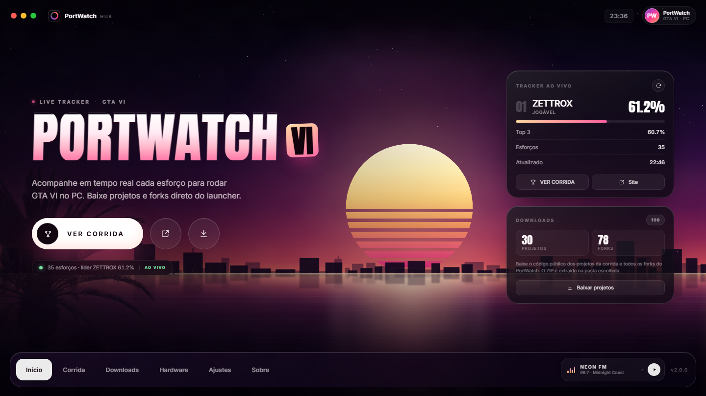

# PortWatch Hub

Uma central de mesa para acompanhar a corrida **PortWatch VI** — os esforços da comunidade para rodar **GTA VI no PC**. O hub lê o tracker oficial ao vivo, ranqueia os projetos, baixa o código público de cada projeto e fork, e ainda verifica se o seu PC aguenta o alvo escolhido.

Feito por **Nicolas Garcia (Nico.SCI)**.



- Site da corrida: <https://portwatch-vi.xyz/#top>
- Tracker no GitHub: <https://github.com/4lwayz/portwatch-vi>

## Baixar pronto para usar

[](https://github.com/breelybr-pixel/portwatch-hub/releases/latest)

Baixe o ZIP na página de **[Releases](https://github.com/breelybr-pixel/portwatch-hub/releases/latest)**, extraia e abra **PortWatch Hub.exe**. Não precisa de Git nem Node.js. Requisitos: Windows 10/11 64-bit.

Se o Windows SmartScreen avisar que o app não tem assinatura, clique em **Mais informações → Executar assim mesmo**.

## O que ele faz

- **Corrida ao vivo:** busca `data/tracker.json` do repositório oficial e aplica o mesmo modelo de pontuação do site (Groundwork → Exe runs → First frame → Main menu → In the world → Playable → Complete, com as trilhas story/render/performance/stability).
- **Leaderboard completo:** projetos ranqueados, builds privadas, watchlist e projetos desativados, com filtros por alvo (GTA VI ou camadas gerais) e ordenação por progresso, estrelas ou atividade.
- **Downloads integrados:** lista todos os projetos públicos do tracker e todos os forks do PortWatch, com busca, progresso e extração automática do ZIP.
- **Hardware:** detecta CPU, GPU, VRAM, RAM e armazenamento, permite simular outras peças e compara o PC com alvos de 1080p a 4K.
- **Temas:** **Vice City** (padrão) e **Los Santos**, com cenário, cores e rádio próprios.
- **Trilíngue:** Português (Brasil), English e Español, com escolha na primeira abertura e troca imediata em Ajustes.
- **Rádio local:** estações synthwave geradas por WebAudio no próprio launcher, sem internet.
- **Cena com parallax:** céu, sol, skyline e reflexo na água reagindo ao mouse.
- **Atualização automática:** o tracker é recarregado no intervalo escolhido (1 a 60 minutos) e pode ser atualizado na hora com o botão ou a tecla `R`.

O hub **não** hospeda, baixa nem linka arquivos do jogo, chaves ou executáveis. Os downloads são apenas os ZIPs públicos dos repositórios do GitHub.

## Como abrir

**Primeira vez:** dê dois cliques em `INICIAR.cmd`. Ele confere o Node.js, instala as dependências automaticamente e abre o hub. Funciona em qualquer pasta — não há caminho fixo.

**No dia a dia:** dê dois cliques em `ABRIR-LAUNCHER.vbs` para abrir sem janela de console. Se as dependências ainda não estiverem instaladas, ele chama o `INICIAR.cmd` sozinho.

**Atalho na área de trabalho:** rode `CRIAR-ATALHO.cmd`. Ele cria um atalho `PortWatch Hub` com o ícone do app, apontando para a pasta atual. Se mover o projeto, rode o script de novo para atualizar o atalho.

**Pelo terminal:**

```powershell
cd "caminho\para\PortWatch Hub"
npm install   # só na primeira vez
npm start
```

Requisitos: Windows 10/11 e Node.js 22 ou mais recente (o npm vem junto).

**Só a interface, sem o app:** `npm run preview` e abra <http://localhost:4317>. O preview inclui proxies same-origin para o tracker e para a API de forks, então a corrida e a lista de downloads funcionam no navegador. Downloads de ZIP e abertura de pastas exigem o app desktop.

## Corrida

A corrida é montada a partir do tracker oficial:

| Grupo | O que mostra |
| --- | --- |
| Ranqueados | Projetos com repositório público, ordenados pela pontuação de 0 a 100. |
| Privados | Esforços sem repositório público, com a base declarada quando existe. |
| Watchlist | Projetos ainda em observação, sem entrar no ranking principal. |
| Desativados | Projetos marcados como encerrados ou removidos. |

Cada cartão mostra a pontuação, a fase alcançada, o alvo, a abordagem, as estrelas, a data do último push e o estado de verificação. Quando o projeto tem repositório público, o botão **Baixar** aparece ali mesmo.

A pontuação é recalculada no launcher com as mesmas regras do site: a escada de milestones vale os primeiros 50 pontos e, a partir de **Playable**, as quatro trilhas (story 35%, render 25%, performance 20%, estabilidade 20%) preenchem os outros 50.

## Downloads

A aba **Downloads** reúne duas fontes:

- **Projetos da corrida:** todos os esforços com repositório público no tracker.
- **Forks do PortWatch:** todos os forks de `4lwayz/portwatch-vi`, ordenados pelo push mais recente.

O ZIP é baixado do GitHub (codeload ou API) e extraído com `Expand-Archive` na pasta escolhida. Se o arquivo tiver uma única pasta raiz, o conteúdo é achatado para ficar direto na pasta do projeto.

A pasta padrão é `Downloads` dentro da pasta do launcher. Use **Escolher pasta** para trocar e **Abrir pasta** para abrir no Explorer. O progresso aparece na própria linha, com fases de download e extração.

Projetos grandes podem demorar. Se a API do GitHub limitar as requisições, preencha um **token do GitHub** em **Ajustes → Tracker** — ele é opcional e fica salvo apenas em `data\config.json`.

## Hardware

A aba **Hardware** detecta o PC atual pelo Windows e transforma cada componente em uma nota de 0 a 100. Depois compara essa nota com o alvo escolhido e mostra o veredito **Pronto para o alvo**, **Jogável com ajustes** ou **Abaixo do recomendado**.

| Alvo | GPU | CPU | RAM | Armazenamento |
| --- | --- | --- | --- | --- |
| 1080p Baixo · 30–60 FPS | 45 | 45 | 50 | 50 |
| 1080p Alto · 60 FPS | 65 | 63 | 65 | 65 |
| 1440p Alto · 60 FPS | 78 | 72 | 76 | 72 |
| 4K Ultra · 60+ FPS | 90 | 82 | 85 | 82 |

A detecção lê o nome da GPU, a VRAM, o modelo e os núcleos da CPU, a quantidade/tipo/velocidade da RAM e o tipo do disco de downloads. Use **Atualizar detecção** para reler o PC. Os selects de peças ficam sempre disponíveis: ao mudar qualquer componente, o modo manual liga sozinho; o interruptor **Usar hardware detectado** volta para a detecção real. As notas são estimativas inspiradas em dados da comunidade; não medem o desempenho real de cada port.

## Temas

- **Vice City** (padrão): anoitecer neon em Leonida, sol listrado, palmeiras e oceano.
- **Los Santos**: sol de San Andreas, colinas, cidade e pier ao entardecer.

A troca é imediata em **Ajustes → Aparência** e muda o cenário, as cores dos menus, os destaques e até os nomes das estações de rádio. A preferência fica salva.

## Atalhos

| Tecla | Ação |
| --- | --- |
| `Enter` | Abre a corrida (fora de menus) |
| `R` | Atualiza o tracker e os forks |
| `Esc` | Fecha menus, diálogos e a folha |
| `F11` | Alterna tela cheia |

A rádio fica no canto direito do dock e começa tocando. Clique no nome ou na seta para abrir a lista de estações; clique no botão redondo para pausar ou continuar. A estação e o estado ficam salvos.

## Ajustes úteis

- **Aparência:** alterna Vice City e Los Santos.
- **Idioma:** aplica na hora e vale para o launcher, avisos e mensagens de erro.
- **Sons da interface:** cliques e passagem do mouse.
- **Música de fundo:** começa junto com o launcher e pode ser pausada no dock ou em Ajustes.
- **Reduzir movimento:** desliga parallax e animações longas.
- **Abrir em tela cheia:** aplica ao iniciar o launcher.
- **Volume da rádio:** volume das estações.
- **Atualizar a cada:** intervalo de recarga automática do tracker.
- **Token do GitHub:** aumenta o limite da API ao listar forks e baixar projetos.
- **Pasta de downloads:** onde os ZIPs são extraídos.
- **Restaurar padrões:** volta às preferências originais, preservando o idioma e a estação de rádio.

As preferências ficam em `data\config.json`.

## Estrutura

```
PortWatch Hub/
  INICIAR.cmd        inicializador: confere o Node, instala dependências e abre
  CRIAR-ATALHO.cmd   cria o atalho na área de trabalho
  ABRIR-LAUNCHER.vbs abre sem janela de console
  main.js            processo principal (janela, IPC, tracker, forks, downloads)
  hardware-main.js   detecção de hardware isolada
  preload.js         ponte segura para o renderer (window.portwatch)
  preview.js         servidor de preview com proxies do tracker e forks
  app/
    index.html       marcação da interface
    styles.css       cena, vidro, tipografia e animações
    portwatch.css    identidade PortWatch, corrida, downloads e tema Los Santos
    app.js           estado, corrida, downloads, ajustes, idioma e navegação
    radio.js         sintetizador das estações
    hardware.js      interface e cálculo do verificador de hardware
    scene.js         estrelas, skyline, parallax e relógio
    i18n.js          textos em português, inglês e espanhol
    assets/          ícone e silhueta da palmeira
    fonts/           Anton, Yellowtail e Inter locais
  tools/
    start.ps1        banner, checagem do ambiente e instalação
    make-shortcut.ps1 cria o atalho da área de trabalho
    ...              captura de tela, teste via CDP e gerador de ícone
  data/config.json   preferências salvas (criado em tempo de execução)
```

O ícone da janela e do atalho é `app\assets\icon.ico`. Para trocar, substitua `icon.png` e rode `npm run icon`; o script gera um ICO com tamanhos de 16 a 256 px. O `CRIAR-ATALHO.cmd` usa esse ícone.

## Créditos

- Launcher, interface e direção visual: **Nicolas Garcia (Nico.SCI)**.
- Corrida, tracker e dados: **PortWatch VI**, de **4lwayz** e colaboradores.
- Silhueta da palmeira derivada da foto **“Phoenix canariensis in silhouette at sunset, Palm Lakes Resort, Ballina NSW”**, de John Robert McPherson, em domínio público (CC0), via Wikimedia Commons.
- Tipografia: **Anton**, **Yellowtail** e **Inter**, sob a SIL Open Font License, com arquivos locais em `app/fonts`.
- O launcher não redistribui arquivos do jogo.

## Problemas comuns

- **“Sem conexão” no tracker:** confira a internet e tente **Atualizar**; se o GitHub estiver fora do ar, o hub usa o último cache local.
- **Lista de forks vazia:** a API do GitHub pode ter atingido o limite. Preencha um token em **Ajustes → Tracker** e atualize.
- **Download falhou:** confira a conexão e o espaço em disco. O detalhe do erro aparece no diálogo.
- **O ZIP não extraiu:** feche o arquivo no Explorer e tente de novo; o download é mantido na pasta de downloads.
- **O launcher não abre:** rode `INICIAR.cmd`; ele mostra o que falta (Node.js, npm ou dependências) e tenta instalar. Se o atalho estiver apontando para uma pasta antiga, rode `CRIAR-ATALHO.cmd` de novo.

---

Projeto pessoal e experimental, sem vínculo com a Rockstar Games ou a Take-Two Interactive. GTA, GTA VI e Los Santos pertencem aos seus respectivos donos.
